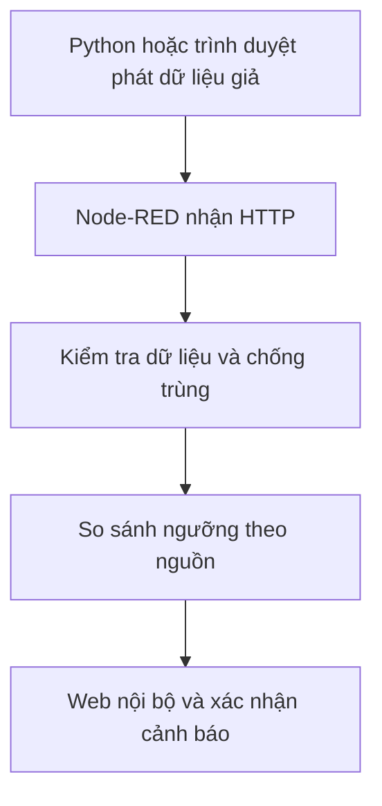

# Industrial AI Monitoring Framework

**Cập nhật 22/10/2026:** đã bổ sung demo AI thật trên VisA PCB4, Node-RED, SQLite và giao diện Inspect.

- [Chạy demo AI thật](pcb4-demo/README.md) · [Chuẩn bị/train baseline](bao-model/TRAINING_README.md) · [Bằng chứng kết quả](Report/evidence/verification-summary.json).
- Model do Giang tự chạy: Image AUROC **94,11%**, recall **31%**, bỏ sót **69/100 ảnh lỗi** ở ngưỡng hiện tại. Chưa có lần cải thiện mô hình; không coi đây là bộ chọn sản phẩm tốt đáng tin cậy.
- HTTP AI thật và cập nhật UI đã được xác minh bằng script; kiểm thử đầy đủ UI mới và restart tiến trình thực còn chưa hoàn tất.
- Tham khảo [repo của Bảo](https://github.com/RoyalB26/AIoT_H261). (Không dùng checkpoint Bảo bàn giao và không nhận benchmark của Bảo là kết quả tái lập của Giang).
- Git không chứa dataset, checkpoint, database vận hành, cache hoặc môi trường Python. Hướng dẫn nêu các đường dẫn môi trường Windows cần điều chỉnh trên máy khác.

---

<details>
<summary>Báo cáo giai đoạn trước: demo HTTP với dữ liệu giả lập</summary>

Các mô tả RAM và “chưa gọi AI thật” bên dưới áp dụng riêng demo giả lập cũ tại /giang-aiot/v1. Demo AI thật tại /giang-pcb4/v1 được mô tả trong báo cáo cập nhật phía trên.

# Industrial AI Monitoring Framework — Báo cáo tiến độ tích hợp HTTP và workflow

**Người thực hiện:** Trần Long Giang (Bò) · **Nhóm:** 1 · **Cập nhật:** 22/10/2026

## 1. Tóm tắt

Đã triển khai demo Node-RED chạy tại chỗ để tiếp nhận dữ liệu mô phỏng đầu ra AI qua HTTP, kiểm tra tính hợp lệ và quản lý vòng đời cảnh báo. Đã kiểm chứng chức năng bằng unit test, browser HTTP, Python HTTP và bài tải 10.000 bản ghi hợp lệ. Giao diện xác nhận và lọc cảnh báo đã được Giang thử trực tiếp, báo hoạt động đúng.

**Demo này chưa gọi mô hình AI thật, chưa đọc ảnh dataset, chưa kết nối MQTT hoặc phần cứng.** Việc kiểm tra workflow đạt không chứng minh độ chính xác của mô hình AI hoặc khả năng vận hành công nghiệp dài hạn.

## 2. Mục tiêu và phạm vi

- Tiếp nhận kết quả từ nhiều nguồn theo một cấu trúc chung.
- Phân biệt bản ghi bình thường, cảnh báo AI, lỗi dữ liệu và lỗi kết nối/xử lý.
- Không tạo thêm cảnh báo khi gửi lại cùng bản ghi; phát hiện ID xung đột.
- Hiển thị nguồn đang hoạt động, chưa có dữ liệu hoặc ngừng gửi dữ liệu hợp lệ.
- Cung cấp workflow có thể xuất/import và kết quả thử nghiệm có thể đối chiếu.

## 3. Luồng hiện tại



`client.py` phát bản ghi; `engine.js` xử lý quy tắc; `config.json` chứa cấu hình; `build_flow.py` đóng gói mã nguồn vào `flow.json`; `demo.html` cung cấp giao diện. Chỉnh source rồi build lại để flow import giữ đúng phiên bản.

## 4. Hành vi đã triển khai

| Tình huống | Hành vi |
|---|---|
| Bản ghi hợp lệ có score dưới ngưỡng | normal, không tạo cảnh báo |
| Score bằng hoặc lớn hơn ngưỡng | Tạo một cảnh báo pending |
| Cùng nguồn và ID, nội dung không đổi | duplicate, không tạo cảnh báo mới |
| Cùng nguồn và ID, nội dung thay đổi | ID_CONFLICT |
| Thiếu trường, sai kiểu, nguồn lạ, timestamp lỗi/cũ/sai thứ tự | Trả lỗi tương ứng, không coi là normal |
| ACK lần đầu | acknowledged, lưu thời gian xác nhận |
| ACK lặp hoặc đồng thời | Chỉ một lần thay đổi, giữ thời gian xác nhận ban đầu |
| ACK mã không tồn tại | 404 ALERT_NOT_FOUND |
| Kho cảnh báo đầy | Từ chối cảnh báo mới với lỗi capacity, không âm thầm xóa pending |

Định danh bản ghi có phạm vi `(source_id, record_id)`. Một bản ghi gồm `record_id`, `source_id`, `timestamp` UTC và `anomaly_score`. Score giả lập hiện giới hạn [0,1]; thang score/ngưỡng cần thống nhất lại khi nối mô hình thật.

## 5. Kết quả kiểm chứng

| Phép kiểm tra | Kết quả | Nguồn chứng cứ |
|---|---|---|
| Engine unit | 15/15 đạt | results/engine-tests.json |
| Workflow offline | 98/98 đạt | results/workflow-unit.json |
| Python unit | 4/4 đạt | Nhật ký kiểm tra cục bộ; bản tóm tắt chia sẻ trong results/verification-summary.json |
| Browser HTTP v2 | 94/94 đạt | Ảnh kết quả Giang cung cấp; chưa có JSON browser v2 trong gói chia sẻ |
| Python HTTP v2 | 93/93 đạt, không bị chặn | results/python-workflow-http.json |
| Build flow | Đạt | results/build-validation.json |
| Deploy | Source khớp flow, 8 route, 15 đối tượng; flow không liên quan giữ nguyên | Kết quả deploy cục bộ, tóm tắt trong results/verification-summary.json |
| Nút ACK và bộ lọc | Giang xác nhận thử thành công | Kiểm tra thủ công, không phải UI test tự động |

Python gộp kiểm tra ACK đầu/lặp vào một assertion, browser tách riêng, nên tổng 93 và 94. Bài offline bổ sung kiểm tra cache, TTL, đầy kho và khởi tạo lại; không thay thế việc restart dịch vụ thật.

Fixture có 80 mẫu, seed 42, kỳ vọng khai báo độc lập với hàm xử lý. Các tình huống mở rộng gồm nhiều nguồn, retry đồng thời, timeout rồi retry cùng bản ghi, ACK đồng thời, nguồn im lặng rồi hoạt động lại. Mã lỗi cố ý được đối chiếu với kỳ vọng, không tính là lỗi ngoài dự kiến. ID phiên và timestamp được tạo mới lúc chạy.

### Bài tải Python HTTP

| Tốc độ mục tiêu (bản ghi/s) | Số bản ghi | Thời gian (s) | Thực đo (bản ghi/s) | Trung vị (ms/request) | p95 (ms/request) |
|---:|---:|---:|---:|---:|---:|
| 100 | 1.000 | 9,01 | 111,03 | 4,87 | 14,75 |
| 500 | 3.000 | 5,80 | 516,88 | 4,43 | 6,08 |
| 1.000 | 6.000 | 5,91 | 1.015,88 | 4,23 | 5,53 |

Tổng 10.000 bản ghi đều có kết quả và được tiếp nhận; không có record error, transport error hoặc unexpected request error. Chứng cứ: `results/python-ramp-v2.json`.

Đây là 100 request tuần tự, batch 100, dữ liệu từ 10 nguồn giả, client/server cùng máy; tổng thời gian khoảng 20,72 giây. Độ trễ là của request, không phải từng bản ghi. Tốc độ thực đo hơi cao hơn mục tiêu do batch đầu gửi ngay và dừng đồng hồ sau batch cuối. Chưa đo tải tối đa, CPU/RAM, chạy dài hạn hoặc suy luận AI trong phép đo này.

## 7. Giới hạn và việc tiếp theo

- Cảnh báo và ACK lưu RAM, mất khi restart/redeploy engine; chưa có database hoặc restore API.
- Tối đa 20.000 cảnh báo, không tự xóa cả mục đã ACK. ACK không giải phóng dung lượng. Đầy kho trả 503 cho bản ghi đơn hoặc kết quả lỗi từng mục trong batch 207.
- Cache chống trùng bản normal: TTL 10 phút, tối đa 20.000 mục. Cảnh báo còn lưu có cơ chế bảo vệ định danh riêng. Không tuyên bố exactly-once qua restart.
- Event ring 1.000 mục độc lập với kho cảnh báo; giao diện hiển thị tối đa 200 mục khớp bộ lọc, JSON chứa toàn bộ cảnh báo đang lưu.
- Dịch vụ giới hạn client loopback. Đưa source lên GitHub không làm localhost của Giang trở thành website dùng chung; mỗi thành viên chạy bản local.
- Chưa có phép so sánh cùng mô hình giữa hai công cụ workflow; chưa tích hợp n8n/ComfyUI, MQTT, cảm biến hoặc camera thật.

Ưu tiên tiếp theo: (1) ghép mô hình của Bảo; (2) kiểm tra ảnh lỗi, model timeout và đối chiếu dự đoán; (3) lưu trạng thái bền vững; (4) so sánh phương án workflow và tích hợp thiết bị theo mốc nhóm thống nhất.

## 8. Hướng dẫn chạy

Môi trường đã thử: Windows, Python 3.11.9, Node.js 24.22.0; Node-RED đã được cài và chạy ở cổng 1880. Python/test JS dùng thư viện chuẩn, không cần cài thêm dependency cho các script này. Chạy lệnh tại thư mục chứa README này.

```powershell
node test_engine.js
node test_workflow.js
python -m unittest test_client -v
python build_flow.py
node verify_build.js
```

Nếu Node-RED chưa chạy, mở terminal riêng và chạy `node-red.cmd`; không mở instance thứ hai nếu cổng 1880 đang dùng. Sau đó:

```powershell
python deploy_demo.py
```

Script chỉ nhắm `127.0.0.1:1880`, dùng revision để tránh ghi đè thay đổi đồng thời, kiểm tra ID/route trùng, backup và đối chiếu flow không liên quan. Deploy reset RAM của demo; backup trạng thái chưa phải chức năng restore.

Mở http://localhost:1880/giang-aiot/v1/demo . Chạy từng bài riêng, không phát dữ liệu khác đồng thời vì test có kiểm tra số cảnh báo và nguồn im lặng:

```powershell
python test_workflow_http.py
python client.py ramp --output results/python-ramp-v2.json
```

Bài workflow HTTP mất khoảng 33 giây do kiểm tra nguồn im lặng. Bài ramp giới hạn batch 100, ba mức 100/500/1.000 bản ghi/s, deadline 60 giây/mức. Các lần chạy ghi đè file kết quả tương ứng; giữ bản sao nếu cần so sánh.

Nếu môi trường công cụ báo WinError 10013, không coi HTTP đã được xác minh trong môi trường đó. Kết quả thành công trong báo cáo này đến từ terminal Windows người dùng và browser, được ghi nhận riêng.

## 9. API và cấu trúc mã nguồn

Tiền tố `/giang-aiot/v1`:

| Method | Route | Vai trò |
|---|---|---|
| POST | /records | Nhận một bản ghi |
| POST | /batch | Nhận lô, tối đa 200 bản ghi |
| GET | /alerts | Danh sách và số lượng cảnh báo |
| POST | /ack | Xác nhận với JSON chứa alert_id |
| GET | /sources | Trạng thái nguồn |
| GET | /metrics | Bộ đếm |
| GET | /events | Vòng đệm sự kiện |
| GET | /demo | Giao diện |

- `engine.js`, `config.json`: xử lý và cấu hình.
- `build_flow.py`, `flow.json`: sinh/import workflow.
- `demo.html`, `workflow_tests.js`, `browser_tests.js`: giao diện và runner trình duyệt.
- `client.py`, `sample-10000.json`: bộ phát và mẫu hiệu năng.
- `mixed_cases.json`, `test_*.js`, `test_*.py`, `verify_build.js`: fixture và kiểm thử.
- `deploy_demo.py`: triển khai riêng demo và backup.
- `results/`: chứng cứ được chọn cho phiên v2.


</details>
