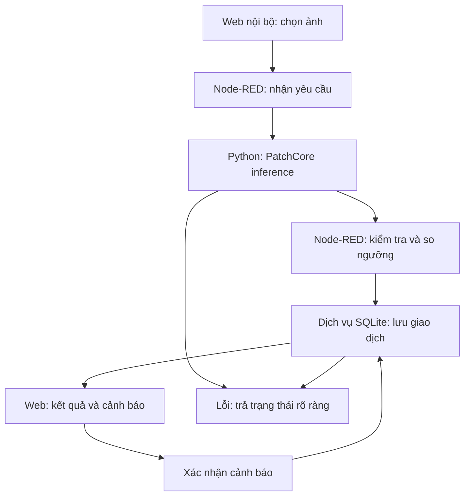

# BÁO CÁO TIẾN ĐỘ DỰ ÁN INDUSTRIAL AI MONITORING FRAMEWORK

**Nội dung:** Mô hình phát hiện bất thường ảnh và tích hợp workflow giám sát  
**Người tổng hợp:** Trần Long Giang — Nhóm 1  
**Ngày chốt số liệu:** 22/10/2026  
**Phạm vi:** Tổng hợp phần mô hình từ repo của Bảo và phần tích hợp, thử nghiệm do Giang triển khai. Chưa phải báo cáo nghiệm thu hệ thống công nghiệp.

## 1. Tóm tắt kết quả

Dự án đã có bản thử chạy tại chỗ theo luồng **ảnh mẫu → mô hình → luật ngưỡng → cảnh báo → web nội bộ**. Phần mô hình tham khảo mã baseline của Bảo; phần tích hợp hiện sử dụng checkpoint do Giang tự tạo trên VisA `pcb4`, không phải checkpoint đã huấn luyện do Bảo bàn giao.

Giang đã kiểm chứng việc nhận ảnh, suy luận trên GPU, chuyển kết quả sang Node-RED, tạo cảnh báo, xử lý gửi lại và xác nhận cảnh báo. Bản v2 bổ sung SQLite để lưu bản ghi và trạng thái ACK. Giao diện Inspect đã được deploy; script xác nhận HTML khớp nguồn, model còn sẵn sàng và cảnh báo được bảo toàn. Chưa hoàn tất kiểm thử thao tác trên toàn bộ giao diện Inspect mới hoặc kiểm chứng dừng/khởi động lại tiến trình thực.

Baseline VisA `pcb4` đạt **Image AUROC 94,11%**, nhưng tại ngưỡng hiện dùng chỉ phát hiện **31/100 ảnh lỗi**, bỏ sót **69 ảnh** và báo nhầm **0/101 ảnh normal**. Vì vậy, kết nối các thành phần đã hoạt động nhưng chất lượng phát hiện lỗi chưa đáp ứng mục tiêu lựa chọn sản phẩm tốt. Chưa có lần huấn luyện cải thiện sau baseline này.

## 2. Nguồn tham khảo và phân định đóng góp

| Nguồn | Nội dung được sử dụng | Cách ghi nhận |
|---|---|---|
| [Repo Bảo — AIoT_H261](https://github.com/RoyalB26/AIoT_H261) | Mã train/inference baseline, tài liệu và bảng benchmark | Kết quả do Bảo báo cáo, chưa được Giang tái lập toàn bộ |
| [Repo Giang — AIOT_Monitoring_workflow](https://github.com/Cowaiiz/AIOT_Monitoring_workflow) | Workflow HTTP, kiểm thử, dịch vụ AI, web và lưu trữ | Kết quả chạy cục bộ được phân biệt theo từng lớp kiểm chứng |
| [VisA — Amazon Science](https://github.com/amazon-science/spot-diff) | Dataset ảnh PCB4 và CSV chia tập | Dữ liệu benchmark, không phải dữ liệu camera/thiết bị thực của nhóm |
| Hướng dẫn dự án của thầy | Hợp đồng khối mô hình, so sánh workflow, mở rộng cảm biến | Dùng làm tiêu chí đối chiếu tiến độ, không coi các đề xuất là hạng mục đã hoàn thành |

Mốc nguồn: repo Bảo tại commit `dbb9e89f3b6feef215f82732cf91407103948510`; repo Giang trước bản cập nhật báo cáo này tại commit `83d626d85c326d5354bbb8f2c1c4c55c3bd4503c`. Bản trên GitHub trước cập nhật chỉ phản ánh demo giả lập; kết quả AI thật dưới đây được bổ sung từ mã và file kết quả cục bộ.

### 2.1. Phần mô hình của Bảo

Repo có `train_baseline/train.py`, `inference_baseline/predictor.py`, `inference_baseline/inference.py` và tài liệu tương ứng. Mã train hỗ trợ MVTec AD, VisA và PCB Defect; cấu hình sử dụng ResNet18, `layer2`/`layer3`, số láng giềng 9. Mã thực thi thay bước KCenterGreedy bằng lấy mẫu ngẫu nhiên, giới hạn bank tối đa 2.000 vector. Vì vậy không mô tả lần triển khai này như greedy coreset PatchCore chuẩn.

Các số dưới đây được trích theo [báo cáo của Bảo tại mốc commit đã đọc](https://github.com/RoyalB26/AIoT_H261/blob/dbb9e89f3b6feef215f82732cf91407103948510/Report/report.md), không phải kết quả đo lại của Giang:

| Dataset | Số danh mục | Image AUROC trung bình | Image F1 trung bình | CPU latency trung bình |
|---|---:|---:|---:|---:|
| MVTec AD | 15 | 85,46% | 90,53% | 37,98 ms |
| VisA | 12 | 81,74% | 80,21% | 40,38 ms |
| PCB Defect | 6 | 66,51% | 87,44% | 26,27 ms |

Báo cáo Bảo ghi riêng VisA `pcb4` có Image AUROC **93,15%**. Không lấy chênh lệch với 94,11% của Giang để kết luận cải thiện: chưa đồng nhất checkpoint, seed, tập fit/calibration, lựa chọn bank và môi trường đo. CPU latency của Bảo và GPU latency của Giang cũng không phải phép so sánh cùng điều kiện.

**Điểm cần đối chiếu trước báo cáo nghiệm thu:** README Bảo ghi VisA Pixel AUROC 97,54%, còn `Report/report.md` để `Null`. Báo cáo chi tiết cũng nhận xét mask VisA chỉ màu đen; dữ liệu PCB4 Giang kiểm tra có các giá trị 0–7 và không có mask rỗng. Do đó không suy ra VisA không có nhãn pixel từ màu hiển thị của mask; chưa sử dụng số pixel metric này làm kết quả đã xác minh. Nhóm cần thống nhất cách đọc/chuyển mask và cập nhật tài liệu nguồn.

### 2.2. Phần Giang triển khai

Giang dựng workflow kiểm tra dữ liệu giả lập trước, sau đó tự chạy một baseline PCB4 để kiểm chứng khối mô hình và đường tích hợp. Các phần bổ sung gồm dịch vụ HTTP inference, hợp đồng dữ liệu, chuẩn hóa thang score, cảnh báo và ACK, chống trùng, SQLite, giao diện Inspect, script build/deploy có backup và các phép kiểm thử. Phần việc này hướng tới vai trò tích hợp IoT/workflow; chưa tích hợp cảm biến thật.

## 3. Dữ liệu, môi trường và phương pháp thí nghiệm của Giang

### 3.1. Chia tập

Dùng VisA `pcb4`, archive `VisA_20220922.tar`, CSV gốc `split_csv/1cls.csv`. Đã đọc kiểm tra 1.105 ảnh và 100 mask, không phát hiện file hỏng; ảnh có kích thước 1358×1104. Nhãn pixel gốc 0–7 được giữ nguyên; chưa báo cáo pixel AUROC/F1.

| Phần dữ liệu | Số ảnh | Mục đích |
|---|---:|---|
| Fit normal | 804 | Trích đặc trưng và tạo memory bank |
| Calibration normal | 100 | Chọn ngưỡng; tách từ 904 ảnh train với seed 42 |
| Test normal | 101 | Đánh giá baseline |
| Test anomaly | 100 | Đánh giá baseline |

Danh sách ảnh từng phần và SHA256 của CSV được lưu trong manifest. Trong lần baseline, tập test không được dùng để chọn ngưỡng. Việc đã xem kết quả test hiện tại phải được tính đến khi thiết kế thí nghiệm tiếp theo: không tối ưu theo tập này rồi gọi kết quả mới là đánh giá độc lập.

### 3.2. Cấu hình và môi trường

Windows, Python 3.11.9, RTX 4060; torch 2.6.0+cu124, torchvision 0.21.0+cu124, anomalib 2.2.0. Baseline dùng ResNet18 pretrained, `layer2`/`layer3`, số láng giềng 9, resize 256×256 và chuẩn hóa ImageNet một lần. Resize không giữ nguyên tỷ lệ gốc là một giới hạn cần xem xét khi cải thiện.

Fit không cập nhật trọng số backbone bằng backpropagation; nó xây dựng bank từ đặc trưng ảnh normal. Giang dùng lấy mẫu ngẫu nhiên theo priority có seed, giữ tối đa 2.000 patch, batch fit 8. Cách này giới hạn bộ nhớ mà không gom toàn bộ patch vào một tensor lớn. Checkpoint riêng lưu dạng `model.pt`; không đưa trực tiếp file này vào loader Lightning `.ckpt` của Bảo.

Ngưỡng gốc là **14,64073657989502**, chọn bằng phân vị 99% (`higher`) của 100 score calibration normal. Đây là quy tắc hạn chế báo nhầm trên dữ liệu normal, không bảo đảm tỷ lệ báo sai thực tế 1% và chưa tối ưu cho mục tiêu giảm bỏ sót.

## 4. Kết quả và phân tích lỗi mô hình

Lần chạy: `visa-pcb4-20261022-213717`. Các số dưới đây đối chiếu với [gói bằng chứng](evidence/verification-summary.json).

| Chỉ số | Kết quả thực đo |
|---|---:|
| Image AUROC | 94,11% |
| Precision tại ngưỡng đã chọn | 100,00% |
| Recall | 31,00% |
| F1 | 47,33% |
| Thời gian fit | 17,17 s |
| Inference trung vị / p95 | 25,03 / 27,39 ms/ảnh |
| Đọc ảnh + tiền xử lý + inference trung vị | 42,39 ms/ảnh |

| Nhãn thật | Dự đoán dưới ngưỡng | Dự đoán cảnh báo | Tổng |
|---|---:|---:|---:|
| Normal | 101 (TN) | 0 (FP) | 101 |
| Anomaly | 69 (FN) | 31 (TP) | 100 |

AUROC đo khả năng xếp hạng khi xét nhiều ngưỡng, không có nghĩa phát hiện đúng 94,11% ảnh lỗi. Ở ngưỡng vận hành hiện tại, recall mới 31%; chưa thể dùng kết quả dưới ngưỡng để kết luận bo mạch tốt. Precision 100% chỉ phản ánh tập test này.

Ba ảnh kiểm tra lại khi nạp checkpoint vào dịch vụ:

| Ảnh trong `pcb4/Data/Images` | Nhãn thật | Score gốc | Kết quả ở ngưỡng 14,6407 |
|---|---|---:|---|
| `Normal/0011.JPG` | Normal | 12,4063 | Dưới ngưỡng — đúng |
| `Anomaly/009.JPG` | Anomaly | 14,8036 | Cảnh báo — đúng |
| `Anomaly/000.JPG` | Anomaly | 12,5620 | Dưới ngưỡng — bỏ sót |

Các score khớp baseline; suy luận lặp cho score giống nhau trên môi trường đã thử. Heatmap chỉ hiển thị độ bất thường tương đối; chưa đối chiếu pixel metric hoặc chứng minh phân vùng lỗi chính xác. Các nguyên nhân như ngưỡng cao, mất chi tiết khi resize hoặc bank chưa đủ đại diện là hướng khảo sát, chưa phải kết luận đã được kiểm chứng.

Độ trễ benchmark đo từng ảnh, có warm-up. Độ trễ trên giao diện còn gồm tạo bản đồ, HTTP và lưu dữ liệu, nên không so trực tiếp với inference-only. Bài tải 10.000 bản ghi của demo cũ chỉ đo HTTP với score giả lập, không chứng minh hệ thống xử lý 10.000 ảnh AI ở cùng tốc độ.

## 5. Kiến trúc tích hợp và hành vi workflow

Đầu vào gồm ảnh JPEG/PNG mã hóa base64, `record_id` và timestamp UTC. Đầu ra mô hình gồm score/ngưỡng gốc, phiên bản model, SHA256 ảnh, thời gian xử lý và heatmap. API dùng tiền tố `/giang-pcb4/v1` với `/demo`, `/infer`, `/health`, `/alerts`, `/ack`. Python chỉ bind loopback, Node-RED kiểm tra client loopback; source công khai không đồng nghĩa dịch vụ localhost được công khai.

Score gốc là khoảng cách, không mặc định thuộc [0,1]. Adapter dùng `s/(s+t)` với `t > 0`; ngưỡng 0,5 tương đương `s >= t`. Giao diện ưu tiên hiển thị score gốc; không gọi score quy đổi là xác suất. Node-RED quyết định normal/alert, tầng lưu trữ kiểm tra tính nhất quán trước commit.

| Tình huống | Hành vi |
|---|---|
| Ảnh hợp lệ, score dưới ngưỡng | Lưu bản ghi normal, không tạo cảnh báo |
| Score bằng hoặc vượt ngưỡng | Tạo một cảnh báo pending |
| Retry cùng ID và nội dung | Duplicate, không tạo cảnh báo mới |
| Cùng ID, nội dung khác | Báo xung đột |
| ACK lần đầu / lần sau | Chuyển acknowledged / giữ thời gian ACK đầu tiên |
| ACK ID không tồn tại | Trả lỗi rõ ràng |
| Ảnh sai, model/kết nối/kho lưu lỗi | Trả lỗi, không biến thành normal |
| Kho đầy | Từ chối bản ghi phù hợp với giới hạn, không tự xóa pending |

SQLite lưu fingerprint, kết quả, cảnh báo và watermark; giới hạn 20.000 cảnh báo, 100.000 bản ghi, chưa có TTL hoặc archive tự động. ACK không giải phóng dung lượng. Cảnh báo RAM v1 được chuyển sang SQLite và giữ ACK; do v1 không xuất fingerprint ảnh đầy đủ, retry ID cũ trả lỗi dành riêng thay vì giả định nội dung giống nhau. Normal/dedup cache v1 không được chuyển.

Giao diện Inspect có khu vực kiểm tra ảnh, kết quả, cảnh báo và thông tin mô hình; kéo thả/chọn ảnh, heatmap overlay, thu phóng, bộ lọc, tìm kiếm, phân trang và xuất JSON. Các tương tác mới này đã được triển khai trong mã; cần hoàn tất kiểm tra sử dụng thực tế trên giao diện mới.

## 6. Kiểm chứng đã hoàn thành và mức độ bằng chứng

| Lớp kiểm chứng | Kết quả | Phạm vi và nguồn |
|---|---|---|
| Demo HTTP giả lập: JS engine / workflow offline | 15/15 và 98/98 đạt | Bằng chứng trong `legacy/http-mock/results/` của repo Giang |
| Demo giả lập: Python unit / Python HTTP | 4/4 và 93/93 đạt | Không phải kiểm thử inference ảnh |
| Demo giả lập: browser HTTP | 94/94 theo ảnh người dùng | Không có JSON tự động v2 trong gói cũ |
| Tải giả lập | 10.000 bản ghi, không lỗi | Không suy diễn thành năng lực AI/camera |
| Checkpoint thật | 3 ảnh khớp baseline, lặp khớp; ảnh lỗi bị từ chối | `local-verification.json` |
| SQLite | 7 nhóm kiểm thử đạt | Bao gồm retry/ACK đồng thời, đầy kho, migration, backup, mở lại DB, rollback khi ghi lỗi |
| Python HTTP AI thật v2 | Đạt | `http-verification.json`: health, normal/alert, duplicate, ACK, ảnh lỗi cố ý, DB mở lại khớp HTTP |
| Build/deploy v2 | Nguồn khớp deploy, flow khác giữ nguyên | Cùng file kết quả HTTP |
| UI mới | Đã deploy; HTML khớp source, cảnh báo giữ nguyên, model ready | `ui-deployment.json`; chưa kiểm thử browser toàn bộ tương tác mới |
| Thao tác UI trước đợt thiết kế lại | Người dùng đã thử ảnh, retry và ACK | Xác nhận/ảnh màn hình trong trao đổi |
| Restart tiến trình thực | Chưa hoàn tất kiểm chứng | Không đánh đồng mở lại DB trong test với dừng/chạy lại toàn bộ dịch vụ |

Các lỗi ảnh cố ý, ID không tồn tại và lỗi ghi dữ liệu mô phỏng được đối chiếu với kết quả mong đợi, không tính là lỗi ngoài dự kiến. Socket trong công cụ trợ lý bị WinError 10013; phép HTTP thành công đến từ terminal Windows của Giang, được đối chiếu file kết quả. Lần kiểm thử lưu trữ ban đầu phát hiện handle backup SQLite chưa đóng; đã sửa và chạy lại đạt.

## 7. Đối chiếu yêu cầu của thầy và công việc tiếp theo

| Yêu cầu | Tiến độ hiện tại | Việc cần hoàn thiện |
|---|---|---|
| Một dataset và model baseline | Đã có VisA PCB4 và checkpoint tự chạy | Cải thiện recall, kiểm tra lỗi dự đoán |
| Khối mô hình có hợp đồng rõ ràng | Có dịch vụ nội bộ, input/output và trạng thái lỗi | Tổng quát cấu hình model/đường dẫn, đo thêm các lỗi timeout |
| Ảnh → mô hình → ngưỡng → sự kiện → web | Đã chạy xuyên suốt | Hoàn thiện test UI mới và khả năng phục hồi |
| Ngưỡng từ cấu hình | Đọc threshold.json, không chọn ngưỡng bằng test | Kiểm thử thay cấu hình có kiểm soát; chưa có chỉnh ngưỡng trên UI |
| Workflow xuất tệp, mã và hướng dẫn | Có build flow và script deploy | Kiểm tra khôi phục/import trên môi trường sạch |
| Hai công cụ cùng ảnh và mô hình | Chưa thực hiện | Thử thêm phương án theo yêu cầu nhóm; lập bảng so sánh thực đo |
| Lưu trạng thái và chạy offline | Có SQLite, nạp checkpoint cục bộ | Thử restart thật, backup/restore, đóng gói và kiểm tra mất Internet |
| Mẫu khối cảm biến giả/thật | Đã có bộ phát HTTP giả lập ở giai đoạn trước | Chuẩn hóa khối cảm biến, MQTT/thiết bị thật sau khi ổn định khối mô hình |

Ưu tiên gần nhất là xác định mục tiêu giảm bỏ sót và tạo validation phù hợp, sau đó thử lần lượt thay bank/chiến lược lấy mẫu hoặc độ phân giải. Ghi trước cấu hình và tiêu chí; giữ baseline làm mốc. Không hạ ngưỡng theo 201 ảnh test rồi báo kết quả đó như kiểm thử độc lập. Chưa có số đo của thí nghiệm cải thiện để đưa vào báo cáo này.

## 8. Bàn giao và phạm vi kết luận

Bản cập nhật Git kèm mã chuẩn bị/train của Giang, dịch vụ inference, SQLite, UI, build/deploy, kiểm thử và các bằng chứng đã chọn. Dataset, checkpoint, `.venv`, cache, database vận hành và backup chứa flow không liên quan không được đưa vào Git. Đường dẫn Windows trong script là cấu hình môi trường đã thử, cần sửa cho máy khác; gói này chưa phải bộ cài dùng ngay trên mọi máy.

Hướng dẫn chi tiết: [demo AI thật](../demo/README.md), [chuẩn bị/train](../model/TRAINING_README.md), [kết quả tổng hợp](evidence/verification-summary.json). Giữ tài liệu demo giả lập cũ để phân biệt các giai đoạn. Nội dung của Bảo được dẫn về repo gốc, không sửa repo của Bảo hoặc nhận các số benchmark đó là kết quả của Giang.

Kết quả hiện tại chứng minh được khả năng ghép khối AI với workflow cảnh báo và web nội bộ. Nó chưa chứng minh mô hình đủ tin cậy để tự động lựa chọn bo mạch tốt, chưa kiểm chứng camera/cảm biến thật và chưa đáp ứng toàn bộ các mốc triển khai của dự án. Đây là cơ sở để thầy đánh giá tiến độ và góp ý cho vòng thí nghiệm tiếp theo.
